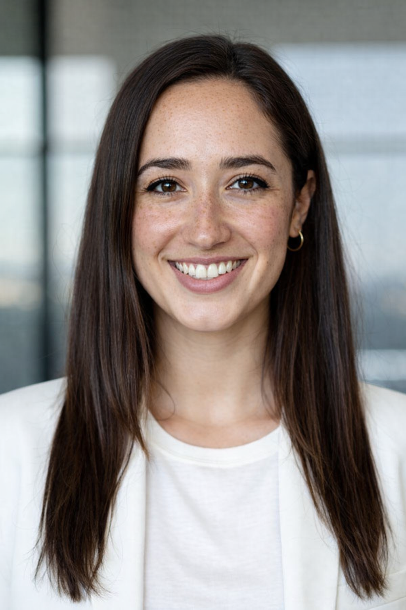
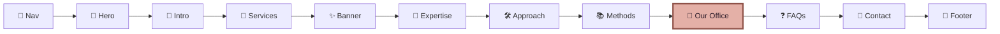
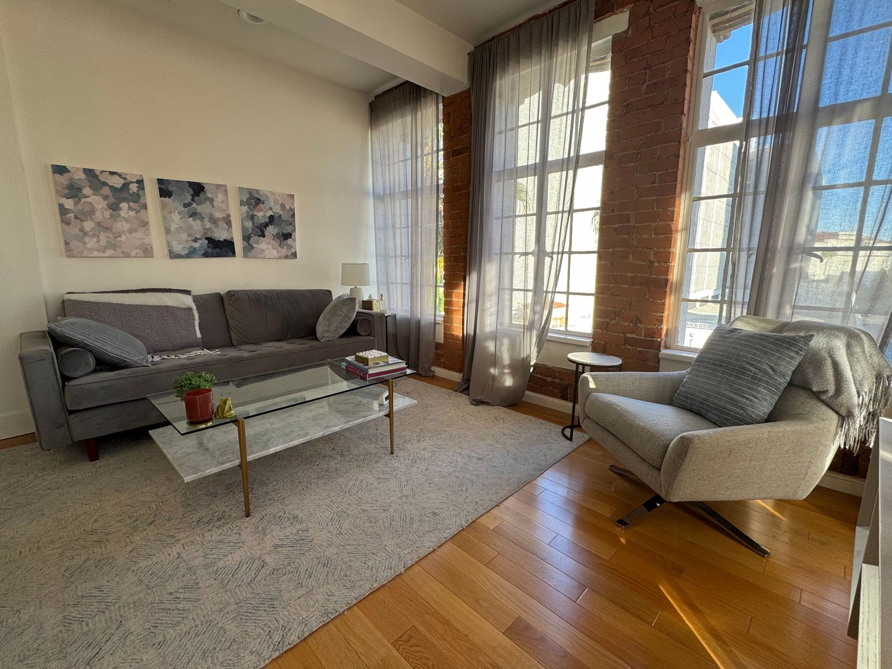
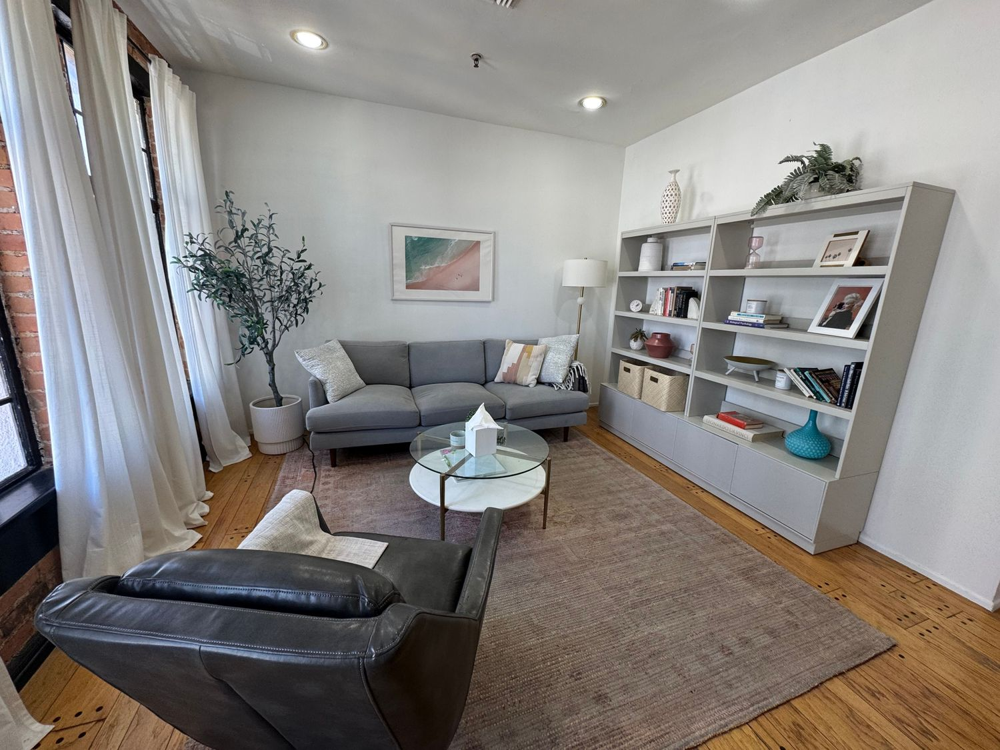

<div align="center">

<br/>



<br/>

# 🌿 Anxiety, Trauma & Burnout Therapy
## in Santa Monica, CA

*A layout clone, creatively redesigned into a calm, warm and SEO-ready therapy website.*

<br/>

<a href="https://maya-therapy-website-red.vercel.app/"></a>
&nbsp;&nbsp;
<a href="https://www.loom.com/share/294eb994caeb4f599609ee1b54d3ebaf"></a>
&nbsp;&nbsp;
<a href="https://github.com/Deeksh870/maya-therapy"></a>

<br/><br/>


<br/>

**[✨ Overview](#-overview) · [🎨 Design](#-design-system) · [🧭 Sections](#-page-walkthrough) · [🔎 SEO](#-seo-strategy) · [🚀 Run it](#-run-it-locally) · [📁 Structure](#-project-structure)**

</div>

<br/>

---

## ✨ Overview

> *"High-achieving on the outside. Overwhelmed within."*

**Dr. Maya Reynolds, PsyD** is an imaginary clinical psychologist based in Santa Monica, California. This project rebuilds a therapy homepage from her profile, which is the **single source of truth** for every word on the page. It was built for the **Cloning & Creative Redesign** assignment, in three parts.

<table>
<tr>
<td width="33%" valign="top">

### 🧬 Part 1 · Clone
Recreated the layout of [conejovalleycounseling.com](https://www.conejovalleycounseling.com/home), keeping the **section order, grids, spacing and responsive behaviour**. Fonts and colors live in reusable theme tokens.

</td>
<td width="33%" valign="top">

### 🎨 Part 2 · Redesign
A new **mauve · sage · blush** palette, **SEO-optimized copy**, three services, an About section with portrait and bio, six FAQs, and new theme-matched imagery.

</td>
<td width="33%" valign="top">

### 🏡 Part 3 · Extend
A brand-new **"Our Office"** section built from the two office photos in her profile, with address, directions and session formats.

</td>
</tr>
</table>

<br/>

## 📊 At a Glance

<div align="center">

| 🧩 Sections | 💆 Services | ❓ FAQs | 🧠 Methods | 🖼️ Images | 🎨 Theme colors |
|:---:|:---:|:---:|:---:|:---:|:---:|
| **12** | **3** | **6** | **4** | **11** | **8** |

</div>

<br/>

## 🎨 Design System

Every color and font is a **design token** in `src/app/globals.css`. Change one value and the whole site restyles.

<div align="center">

| Swatch | Token | Hex | Role |
|:---:|---|:---:|---|
|  | `plum` | `#402b3a` | Headings, nav, footer |
|  | `plum-deep` | `#2d1d2a` | Overlays and dark bars |
|  | `cream` | `#f8f1e9` | Page background |
|  | `blush` | `#e8d8d0` | Soft panels |
|  | `sage` | `#e4e8de` | Calm sections |
|  | `rose` | `#8f5249` | Buttons, links, accents |
|  | `rose-soft` | `#c98278` | Decoration |
|  | `muted` | `#675259` | Body text |

</div>

**Why this palette?** Mauve, sage and blush feel calm, warm and grounded. They avoid the clinical blues and greens common on therapy sites, and the dark plum keeps text sharp and readable.

| Role | Font |
|---|---|
| ✒️ Headings | **Cormorant Garamond**, an elegant, trustworthy serif |
| 📖 Body | **Mulish**, clean and easy to read |
| 🖋️ Accent words | **Pinyon Script**, a personal, handwritten touch |

<br/>

## 🧭 Page Walkthrough



<div align="center">

<table>
<tr>
<td align="center" width="25%"><br/><b>Anxiety & Panic</b></td>
<td align="center" width="25%"><br/><b>Trauma & EMDR</b></td>
<td align="center" width="25%"><br/><b>Burnout & Perfectionism</b></td>
</tr>
</table>

</div>

| # | Section | What it does |
|:-:|---|---|
| 1 | **Sticky navigation** | Smooth-scroll links and a mobile hamburger menu |
| 2 | **Hero** | SEO-focused H1 with the keyword and location, a call to action, and Dr. Maya's portrait in a leaf-shaped frame |
| 3 | **Introduction** | "Does any of this sound familiar?" for instant self-recognition |
| 4 | **How I help** | Three services in matching square cards |
| 5 | **Quote banner** | Full-width image with an overlay and a reassuring quote |
| 6 | **Areas of expertise** | Numbered panel covering 12 concerns |
| 7 | **How I work** | Approach and insight, each beside a supporting image |
| 8 | **Methods** | CBT, EMDR, Mindfulness-Based Practices, Body-Oriented Techniques |
| 9 | **🏡 Our Office** ⭐ | *New section.* Two office photos, address, directions, in-person and telehealth details |
| 10 | **FAQs** | Six questions in an accessible accordion |
| 11 | **Contact** | Two-column layout with a working consultation form |
| 12 | **Footer** | Four-column footer with a credentials bar |

<br/>

## 🏡 The New Section: Our Office

<div align="center">

<table>
<tr>
<td align="center" width="50%"></td>
<td align="center" width="50%"></td>
</tr>
</table>

*A calm, private space in Santa Monica, designed to help clients feel safe from the first session.*

</div>

<br/>

## 🔎 SEO Strategy

| ✅ | Technique | Where |
|:-:|---|---|
| ✅ | Primary keyword and **location in the H1** | Hero |
| ✅ | Keywords in **H2 and H3 headings** | Every section |
| ✅ | Descriptive, keyword-aware **image alt text** | All images |
| ✅ | Optimized **title and meta description** | `layout.tsx` |
| ✅ | **JSON-LD** `ProfessionalService` structured data | `page.tsx` |
| ✅ | Natural keyword use in body copy, with no stuffing | Throughout |
| ✅ | Semantic HTML and a clear heading hierarchy | Throughout |

<div align="center">

| 🔍 SEO | ♿ Accessibility |
|:---:|:---:|
|  |  |

</div>

<br/>

## ♿ Built for Everyone

- 🎯 Strong text contrast on every background
- 🏷️ Labelled form fields and descriptive alt text
- ⌨️ Visible keyboard focus states
- 🐢 Reduced-motion support
- 📱 Tested from phone to widescreen

<br/>

## 🚀 Run it Locally

```bash
# 1 · clone
git clone https://github.com/Deeksh870/maya-therapy.git
cd maya-therapy

# 2 · install
npm install

# 3 · run
npm run dev          # → http://localhost:3000

# 4 · production build
npm run build
```

<details>
<summary><b>💌 Set up the contact form</b></summary>

<br/>

Get a free access key at [web3forms.com](https://web3forms.com), then edit the top of `src/app/page.tsx`:

```tsx
const ACCESS_KEY = "your-web3forms-access-key";
const CONTACT_EMAIL = "you@example.com";
const CONTACT_PHONE: string = ""; // optional
```

</details>

<details>
<summary><b>🎨 Change the colors</b></summary>

<br/>

Edit the tokens in `src/app/globals.css`:

```css
@theme inline {
  --color-plum: #402b3a;
  --color-cream: #f8f1e9;
  --color-rose: #8f5249;
  /* ...the whole site updates */
}
```

</details>

<br/>

## 📁 Project Structure

```
maya-therapy/
├── public/
│   ├── portrait.png          # Dr. Maya
│   ├── office1.jpeg          # Office photos
│   ├── office2.jpeg
│   ├── service-anxiety.jpg   # Service cards
│   ├── service-trauma.jpg
│   ├── service-burnout.jpg
│   ├── intro-calm.jpg
│   ├── approach.jpg
│   ├── insight.jpg
│   ├── banner.jpg
│   └── contact-left.jpg
├── src/app/
│   ├── layout.tsx            # Fonts + SEO metadata
│   ├── page.tsx              # The homepage
│   └── globals.css           # Theme tokens
└── README.md
```

<br/>

## 🛠️ Tech Stack

| Layer | Tool |
|---|---|
| Framework | **Next.js 16** (App Router, Turbopack) |
| Language | **TypeScript** |
| Styling | **Tailwind CSS v4** |
| Fonts | **next/font/google** |
| Forms | **Web3Forms** |
| Hosting | **Vercel** |

<br/>

## 📝 Content Note

All content is based on **Dr. Maya Reynolds' profile**. She is an imaginary therapist created for this design exercise, and the address and contact details are placeholders.

<br/>

---

<div align="center">

### 💜 Designed & built by **Deekshitha S**

<a href="https://maya-therapy-website-red.vercel.app/"></a>

<sub>If you liked this project, please leave a ⭐</sub>

</div>
